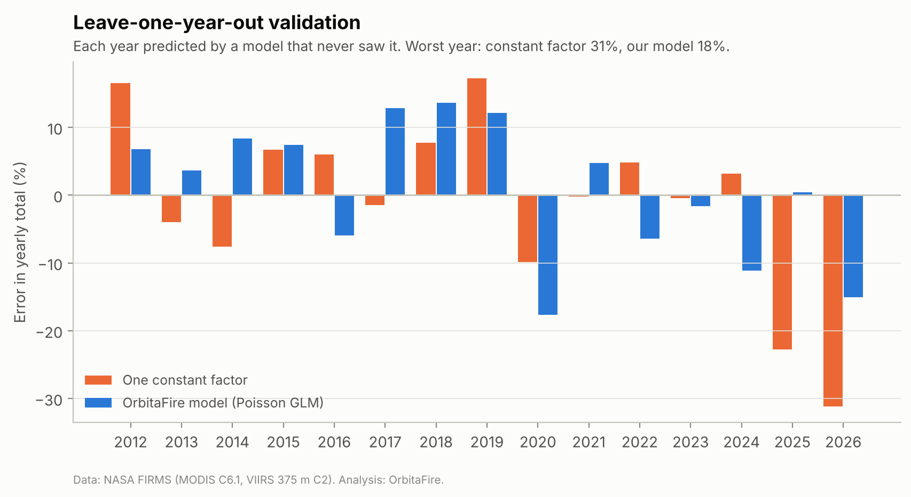
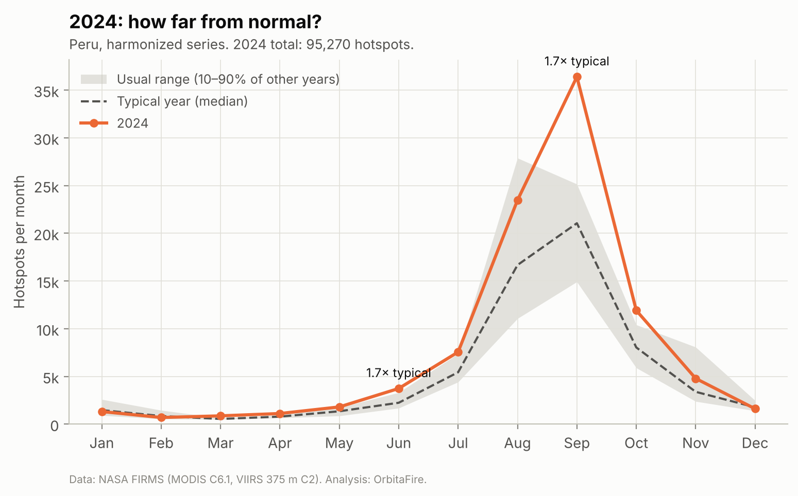
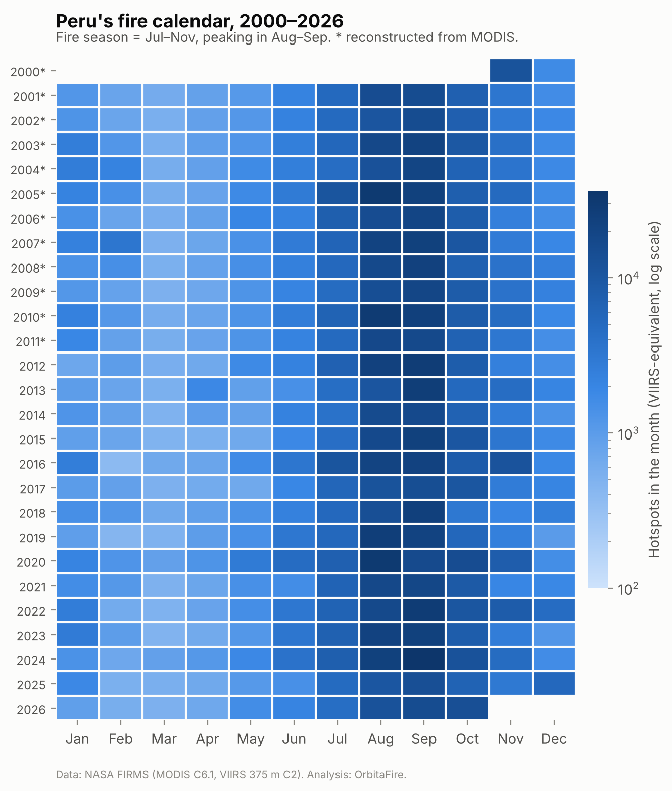
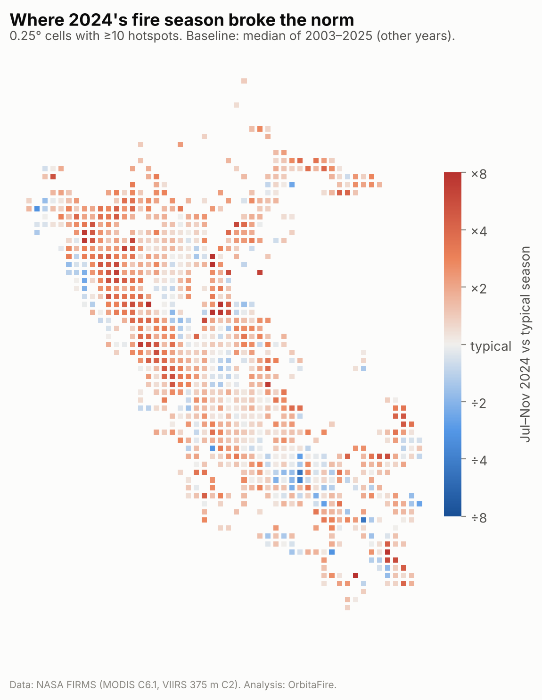

# OrbitaFire 🔥🛰️

**Harmonizing 20+ years of NASA active-fire hotspots (MODIS + VIIRS) into one consistent record, with a burning-activity calendar and early-warning alerts. Pilot: the Peruvian Amazon and Andes.**

Team **OrbitaFire** · NASA Space Apps Challenge 2026 · Local Event: Lima, Peru
Challenge: *Harmonization of MODIS and VIIRS Hot Spots*

> 🚧 Work in progress during the hackathon (Nov 14–15, 2026).

## Data

All fire data come from **NASA FIRMS** (Fire Information for Resource Management System), Archive Download, area of interest **Peru**, 2000-11-01 → 2026-11-12:

| Source | Satellite(s) | Coverage |
|---|---|---|
| MODIS Collection 6.1 | Terra + Aqua | Nov 2000 → present |
| VIIRS 375 m (C2) | Suomi NPP | Jan 2012 → 2 Nov 2026 (S-NPP stopped delivering data) |
| VIIRS 375 m (C2) | NOAA-20 | Apr 2018 → present |
| VIIRS 375 m (C2) | NOAA-21 | Mar 2023 → present |

Raw downloads go in `data/raw/{modis,snpp,noaa20,noaa21}/` (not versioned).

## Pipeline

```bash
pip install -r requirements.txt
python scripts/01_prepare_data.py --raw data/raw --out data/processed --res 0.25
python scripts/02_harmonize.py --processed data/processed --results results   # ~6 min
python scripts/03_results.py --processed data/processed --results results --figures figures
python -m pytest -q tests
```

**Step 1 – clean and grid.** Keeps confident detections (MODIS confidence ≥ 30; VIIRS nominal/high), keeps presumed vegetation fires only (`type == 0` in archive data; static-source cells removed from near-real-time data, which has no `type`), and aggregates every satellite to a common 0.25° grid × month panel (zeros included).

**Step 2 – harmonize.** Produces one *VIIRS-equivalent* hotspot series for Nov 2000 – Nov 2026.

1. **VIIRS reference.** S-NPP is the reference sensor. On 56 days when S-NPP was not observing, and after its shutdown on 2026-11-01, NOAA-20 detections are used, scaled by k = 1.008. That factor is learned from 2,157 days when both satellites flew.
2. **MODIS → VIIRS.** The VIIRS/MODIS ratio is *not* constant. It is about 4 in strong fire months and above 8 in quiet ones, because VIIRS (375 m) sees small fires that MODIS (1 km) misses. Five models are compared with **leave-one-year-out** validation over 2012–2026; each year is predicted by a model that never saw it. The chosen **Poisson GLM** works cell by cell, using log1p(MODIS), month of year, their interaction, and the cell's fire regime. A constant factor misses a whole year by up to 31%; this model's worst year is off by 18%. It also ranks cells better (Spearman 0.89 vs 0.86).
3. **Terra-only years (Nov 2000 – Jul 2002).** Aqua was not yet flying, so a Terra → VIIRS model is trained on 2012–2019, before Terra's orbit drift. Its leave-one-year-out yearly error is 6% on average and 16% at worst.
4. **Uncertainty.** Reconstructed months and years carry a 95% band. It is computed from the out-of-fold errors, separately for the fire season and the rest of the year.

Outputs are written to `results/`: the Peru monthly and yearly harmonized series, the model comparison tables, yearly errors and `harmonize_report.json`. A cell-level harmonized panel goes to `data/processed/`.

**Step 3 – results.** Run `python scripts/03_results.py`. It works on the harmonized series:

- **Fire calendar.** The typical share of each year's fires that falls in each month. In Peru, 82% of fires happen in Jul–Nov, with the peak in Aug–Sep.
- **Anomalies.** Every month and year is compared with the same period in the *other* years, using a robust z-score (median/MAD), and placed in a category: very low / normal / high / very high / extreme. Each 0.25° cell's fire season is compared the same way.
- **Current status.** The latest complete month and the year-to-date, as a "traffic light" for the website.

Key results:

- **2024 is the record year** at 95,270 hotspots, 1.5× a typical year. In September 2024 alone there were 36,394 hotspots, 1.7× a typical September.
- 81% of active cells were above their usual fire season, so the 2024 anomaly was widespread across the country.
- **2005 (88.6k, 95% band 72k–109k) and 2010 (83.2k) were of similar size.** Raw MODIS shows only 21k and 18k for those years, so this is visible only after harmonization.
- **October 2026 was 1.65× a typical October** ("very high"), even though 2026 overall is normal so far.

| | |
|---|---|
|  |  |
|  |  |
|  |  |

## AI assistance

In line with the NASA Space Apps 2026 Project Submission Guide, we disclose that this project was developed **with AI assistance**:

- **Claude (Anthropic)** was used to help write and review the Python code in this repository (data loading, cleaning, gridding and harmonization), to help design the validation approach, and to help draft documentation. Files developed with AI assistance carry a header note saying so.
- All analysis decisions, results and their interpretation were reviewed by the team.

## Acknowledgments

We acknowledge the use of data and/or imagery from NASA's Fire Information for Resource Management System (FIRMS) (https://earthdata.nasa.gov/firms), part of NASA's Land, Atmosphere Near real-time Capability for Earth observations (LANCE) (https://earthdata.nasa.gov/lance) and NASA's Earth Science Data and Information System (ESDIS).

## License

Code: MIT (see `LICENSE`). Data: NASA FIRMS (open data).
