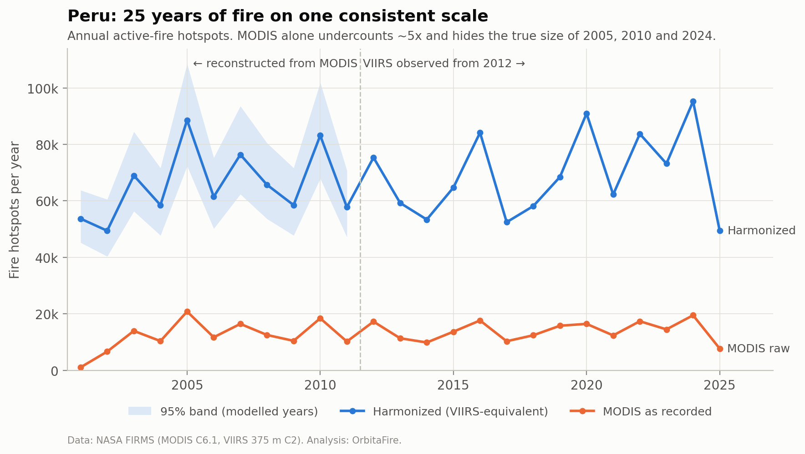
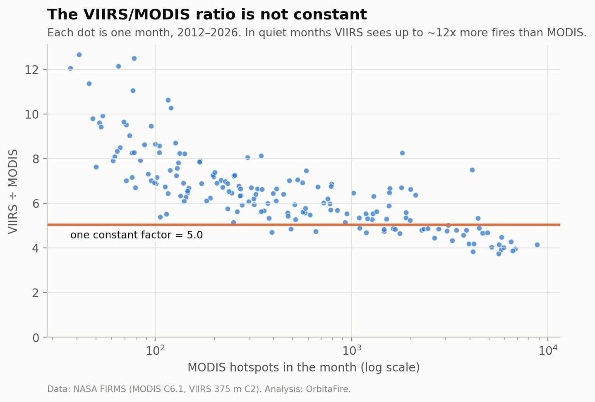

# OrbitaFire 🔥🛰️

**Harmonizing 20+ years of NASA active-fire hotspots (MODIS + VIIRS) into one consistent record, with a burning-activity calendar and early-warning alerts. Pilot: the Peruvian Amazon and Andes.**

Team **OrbitaFire** · NASA Space Apps Challenge 2026 · Local Event: Lima, Peru
Challenge: *Harmonization of MODIS and VIIRS Hot Spots*

> 🚧 Work in progress during the hackathon (Nov 14–15, 2026).

## Data

All fire data come from **NASA FIRMS** (Fire Information for Resource Management System), Archive Download, area of interest **Peru**, 2000-11-01 → 2026-11-12:

| Source | Satellite(s) | Coverage |
|---|---|---|
| MODIS Collection 6.1 | Terra + Aqua | Nov 2000 → present |
| VIIRS 375 m (C2) | Suomi NPP | Jan 2012 → 2 Nov 2026 (S-NPP stopped delivering data) |
| VIIRS 375 m (C2) | NOAA-20 | Apr 2018 → present |
| VIIRS 375 m (C2) | NOAA-21 | Mar 2023 → present |

Raw downloads go in `data/raw/{modis,snpp,noaa20,noaa21}/` (not versioned).

## Pipeline

```bash
pip install -r requirements.txt
python scripts/01_prepare_data.py --raw data/raw --out data/processed --res 0.25
python scripts/02_harmonize.py --processed data/processed --results results   # ~6 min
python scripts/03_results.py --processed data/processed --results results --figures figures
python -m pytest -q tests
```

**Step 1 – clean and grid.** Keeps confident detections (MODIS confidence ≥ 30; VIIRS nominal/high), keeps presumed vegetation fires only (`type == 0` in archive data; static-source cells removed from near-real-time data, which has no `type`), and aggregates every satellite to a common 0.25° grid × month panel (zeros included).

**Step 2 – harmonize.** Produces one *VIIRS-equivalent* hotspot series for Nov 2000 – Nov 2026.

1. **VIIRS reference.** S-NPP is the reference sensor. On 56 days when S-NPP was not observing, and after its shutdown on 2026-11-01, NOAA-20 detections are used, scaled by k = 1.008. That factor is learned from 2,157 days when both satellites flew.
2. **MODIS → VIIRS.** The VIIRS/MODIS ratio is *not* constant. It is about 4 in strong fire months and above 8 in quiet ones, because VIIRS (375 m) sees small fires that MODIS (1 km) misses. Five models are compared with **leave-one-year-out** validation over 2012–2026; each year is predicted by a model that never saw it. The chosen **Poisson GLM** works cell by cell, using log1p(MODIS), month of year, their interaction, and the cell's fire regime. A constant factor misses a whole year by up to 31%; this model's worst year is off by 18%. It also ranks cells better (Spearman 0.89 vs 0.86).
3. **Terra-only years (Nov 2000 – Jul 2002).** Aqua was not yet flying, so a Terra → VIIRS model is trained on 2012–2019, before Terra's orbit drift. Its leave-one-year-out yearly error is 6% on average and 16% at worst.
4. **Uncertainty.** Reconstructed months and years carry a 95% band. It is computed from the out-of-fold errors, separately for the fire season and the rest of the year.

Outputs are written to `results/`: the Peru monthly and yearly harmonized series, the model comparison tables, yearly errors and `harmonize_report.json`. A cell-level harmonized panel goes to `data/processed/`.

**Step 3 – results.** Run `python scripts/03_results.py`. It works on the harmonized series:

- **Fire calendar.** The typical share of each year's fires that falls in each month. In Peru, 82% of fires happen in Jul–Nov, with the peak in Aug–Sep.
- **Anomalies.** Every month and year is compared with the same period in the *other* years, using a robust z-score (median/MAD), and placed in a category: very low / normal / high / very high / extreme. Each 0.25° cell's fire season is compared the same way.
- **Current status.** The latest complete month and the year-to-date, as a "traffic light" for the website.

Key results:

- **2024 is the record year** at 95,270 hotspots, 1.5× a typical year. In September 2024 alone there were 36,394 hotspots, 1.7× a typical September.
- 81% of active cells were above their usual fire season, so the 2024 anomaly was widespread across the country.
- **2005 (88.6k, 95% band 72k–109k) and 2010 (83.2k) were of similar size.** Raw MODIS shows only 21k and 18k for those years, so this is visible only after harmonization.
- **October 2026 was 1.65× a typical October** ("very high"), even though 2026 overall is normal so far.

**Step 3b – protected areas.** Run `python scripts/04_protected_areas.py`. Every VIIRS hotspot from 2012 to Oct 2026 is tested point-in-polygon against SERNANP's official boundaries of Peru's national protected areas and their buffer zones. The buffer zone is counted as a ring outside the area. The native communities that intersect each unit are also listed. The script writes `results/protected_areas_fire.csv` and `results/protected_areas_monthly.csv`, plus a ranking of the 11 Communal Reserves co-managed by SERNANP and Indigenous organizations (`results/communal_reserves_ranking.csv`).

- **El Sira** (Huánuco, Pasco, Ucayali) has by far the most fire of any Communal Reserve: about 2,400 hotspots a year in its landscape, mostly in the buffer zone, where 213 native communities are found.
- **Amarakaeri** (Madre de Dios) has almost no fire inside the reserve, but fire in its buffer zone has roughly **tripled**: from about 55 hotspots a year in 2012–2018 to 196 in 2024, its record year (2.8× its usual level). This is the early-warning case.

SERNANP layers are downloaded from SERNANP's public download service (`geoservicios.sernanp.gob.pe`, `sernanp_visor/servicio_descarga`, layers 1, 8 and 39). Raw layers are not stored in this repository. The website uses simplified outlines derived from them, credited to SERNANP.

| | |
|---|---|
|  |  |
|  |  |
|  |  |

**Step 4 – website.** `python scripts/05_build_web.py` writes compact data to `docs/data/`. `docs/` is a static site (Leaflet + plain JavaScript, no build step) with an EN/ES toggle. It has these parts:

- a national fire "traffic light"
- an interactive map: click any place to see its harmonized fire history, the protected area or buffer zone it falls in, and the native communities nearby
- the Communal Reserves ranking
- the method and validation charts

`docs/3d.html` is a self-contained 3D view built by `python scripts/06_build_3d.py` with MapLibre GL JS (BSD-3). It shows fire columns per cell and year over NASA GIBS Blue Marble imagery and AWS Terrain Tiles relief, with a year slider. To preview the site: `cd docs && python -m http.server`. To publish it: enable GitHub Pages from `main` / `docs`.

## Monthly observatory

The 2D map now shares its location selection with the Fire Activity Calendar,
year/month comparisons, seasonal advisories, territorial attention table and
monthly anomaly indicators. Select protected area/cell/department in the map
control, or choose a location in the calendar. The territorial table keeps reserve
interiors and buffer rings separate. EN/ES and bar/heatmap views are available.

Build the monthly datasets from the existing pipeline outputs without rerunning
or refitting the harmonization model:

```bash
python scripts/05_build_web.py --observatory-only
python scripts/08_build_experience.py
python scripts/06_build_3d.py
python -m pytest -q tests
python -m http.server 8765 --directory docs --bind 127.0.0.1
```

Open `http://127.0.0.1:8765`. The observatory uses `docs/data/observatory.json`
and location bundles in `docs/data/observatory/`; cell data loads in blocks of 50.
The full step-05 export also generates these files when its external layers are
available. `--observatory-only` reuses existing display outlines and CSV/Parquet.

Regional totals are approximate whole-grid-cell assignments using simplified
boundaries. Protected-area monthly counts reuse the existing original-polygon
results and do not include pre-2012 reconstructed grid estimates. Incomplete
January 2012 and November 2026 are identified and excluded from comparisons.
Daily anomalies and recomputing exact protected-area/community intersections
require further preparation/original geographical inputs. See
[data availability and methods](docs/DATA_AVAILABILITY.md) for exact missing
filenames, provenance, statistical definitions, coverage and limitations.

## AI assistance

In line with the NASA Space Apps 2026 Project Submission Guide, we disclose that this project was developed **with AI assistance**:

- **Claude (Anthropic)** was used to help write and review the Python code in this repository (data loading, cleaning, gridding and harmonization), to help design the validation approach, and to help draft documentation. Files developed with AI assistance carry a header note saying so.
- All analysis decisions, results and their interpretation were reviewed by the team.

## Acknowledgments

We acknowledge the use of data and/or imagery from NASA's Fire Information for Resource Management System (FIRMS) (https://earthdata.nasa.gov/firms), part of NASA's Land, Atmosphere Near real-time Capability for Earth observations (LANCE) (https://earthdata.nasa.gov/lance) and NASA's Earth Science Data and Information System (ESDIS).

## License

Code: MIT (see `LICENSE`). Data: NASA FIRMS (open data).


## Interactive experience

The initial welcome screen opens Control. Geographic search includes existing
public territory/community names; community search navigates to a coarse grid
cell, not a newly inferred community polygon. Historical/observed/anomaly layers
use `control.json`, repacked from the verified observatory series by step 08.
The contextual panel retains comparisons, individual year selection, seasonal
statistics and detailed territorial/anomaly tables. About / Methodology retains
the existing scientific validation. Historical Explorer embeds the existing
MapLibre view and supports annual/monthly values, previous/next, speed and playback.
The 2000 record starts in November; partial periods have no full-year ratio.
Daily comparisons remain unavailable pending the documented daily export.

Landing photograph: USDA Forest Service / Henny Jungemann, public domain.
See `docs/assets/CREDITS.md`. It illustrates a Minnesota forest fire, not current
activity in Peru. All image assets are local WebP derivatives.


## Contextual comparisons and daily observations

The OrbitaFire logo returns to the welcome view using same-page history; browser
Back restores the previous view. Location selection initially shows a short status
for the selected month/year and separately identifies the latest complete observed
period. View Details compares chosen years; View History shows the full monthly
record. Both use a fixed red count palette (log1p scale, darkest at the actual maximum of the harmonized national record).

Run `python scripts/09_build_comparisons.py` to generate `daily.json`, lazy daily
cell/national shards and `sectors.json` from the cleaned observations and existing
geometries. Daily/weekly comparisons use only the S-NPP/NOAA-20 observed reference
from 2012-01-20 onward; no monthly prediction is split into days. The latest day is
excluded as potentially incomplete. A zero denotes no reference detection in the
record, not proof of observation visibility. Weeks are calendar-month blocks
1–7, 8–14, 15–21, 22–28, 29–month-end (final block can be shorter), not ISO weeks.
Daily/weekly reserve or department aggregates remain unavailable; controls are
disabled rather than attributing coarse grid data to original polygons.

Most Active Sector is approximate and uses only whole cells contained in the
available display polygon with a conservative 0.005° inner margin. Original
boundaries are missing; this is not a verified ignition location or risk score.
No marker is produced for zero, unavailable or spatially unverifiable sectors.
